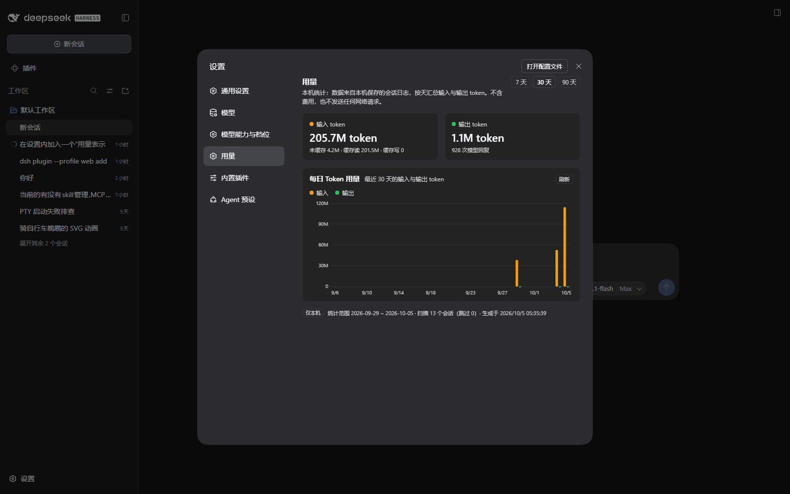

# betterDSH

一组让 **DSH（DeepSeek Harness）** 更好用的插件合集。每个插件都是独立可装载的 bundle：
Host 半边在认证的 `/api` 通道上注册路由，Client 半边以 `window.__ModuleLoader__.load`
形态注册到 Web GUI 的某个槽位（设置页 / 设置分区 / 会话界面），**无需构建步骤**。

仓库里的 5 个插件同步自工作区最新源码。发行目录与本机 `link:` 开发安装分离，使用可移植包名加载；不会改动本机运行配置。账号池保留当前激活的 `runtime-v0.4.18-probe-retries` 宿主快照（已核对与普通源码逐文件一致），包版本仍沿用源码声明的 `0.4.8`。

## 插件一览

| 插件 | 版本 | 作用 | 挂载点 |
| --- | --- | --- | --- |
| [`dsh-usage-report`](dsh-usage-report/README.md) | 0.1.0 | 设置里的「用量」页：按天统计本机会话输入/输出 token（纯本地，无外网请求、无计费数据） | `settings.section` (id `usage`) |
| [`dsh-account-pool`](dsh-account-pool/README.md) | 0.4.8 | 账号池：两层选路（粘性会话 + 负载感知）、失败冷却与降级 | 设置页 + Host 上游适配 |
| [`dsh-context-window`](dsh-context-window/README.md) | 0.4.2 | 输入框下方「白圈」点开的弹层：官方占用投影 + 宿主分类（MCP 工具两层展开 / 系统工具 / 技能） | 会话输入区 |
| [`dsh-github`](dsh-github/README.md) | 0.1.0 | 设置里的 GitHub 管理页、`/github` 人类命令、远程仓库克隆进工作区 | `settings.section` + 命令 |
| [`dsh-mcp-skills`](dsh-mcp-skills/README.md) | 0.1.0 | 设置里的「MCP 与技能」页：统一管理 MCP 服务器（启停/配置/工具数）与技能库 | `settings.section` |

每个插件的完整说明、架构、实测数据与已知限制都在它自己的 `README.md` 里；
`dsh-account-pool` 另有一份 49 KB 的 [`DESIGN.md`](dsh-account-pool/DESIGN.md)。



## 仓库结构

```
betterDSH/
├── dsh-usage-report/          # 每个插件一个顶层目录，目录名 = 包名
│   ├── package.json           #   dsh.bundle.patch + dsh.client(platform: web) 声明
│   ├── cordis.patch.yml       #   往 profile 里插入一行条目
│   ├── lib/                   #   host.js / client.js（手写 JS，无构建）
│   ├── docs/screenshots/      #   实机截图
│   ├── tools/                 #   零依赖测试与诊断脚本
│   └── README.md
├── dsh-account-pool/
├── dsh-context-window/
├── dsh-github/
└── dsh-mcp-skills/
```

## 安装

DSH 的插件装载由 **profile** 驱动。以 `desktop` profile 为例，两处需要改：

1. `C:\Users\Administrator\.dsh\profiles\desktop\package.json`
   - `dependencies` 加一行：`"dsh-usage-report": "link:<本仓路径>/dsh-usage-report"`
   - `dsh.profile.bundles` 追加：`dsh-usage-report`
2. profile 的 `cordis.patch.yml` 末尾由插件管理器写入一行：`- id: usage-report` / `disabled: false`

通常不必手写，交给插件管理器：

```powershell
# 安装（把路径换成你克隆下来的位置）
plugin_manager install_bundle target = "<本仓路径>\dsh-usage-report"
# 卸载
plugin_manager remove_bundle  target = "dsh-usage-report"
```

安装后 profile 的 `node_modules/<包名>` 是指向插件目录的 **链接**，
因此修改你实际安装的目录后，刷新 GUI 可更新客户端；宿主模块更新需要重启 DSH。工作区开发安装若仍链接原源码目录，不会受这个发行副本影响。

### 可移植发行配置

全部插件的 `cordis.patch.yml` 使用包名加载，无需修改本机绝对路径。
发行默认值不包含开发机器的诊断输出路径、旧会话统计数据路径或操作员账号定义。
账号池通过 `package.json` 的主入口加载当前宿主快照，保留检测重试配置；
安装后请自行添加账号和凭据，不会预置主号、备号或 Anyrouter 账号。

宿主模块按导入标识缓存，**更新插件后请重启 DSH**；客户端更新后刷新 GUI。
各插件 README 中描述的本机绝对路径、调试和热切换步骤仅属于开发环境，不是发行安装要求。

## 测试

除 `dsh-account-pool` 需要 `zod` 外，其余插件**零依赖**，测试脚本也都不需要网络：

```powershell
cd dsh-usage-report   ; node tools/report-test.mjs; node tools/host-test.mjs; node tools/client-test.mjs
cd dsh-context-window ; node tools/host-test.mjs;   node tools/client-test.mjs
cd dsh-github         ; node tools/pure-test.mjs;   node tools/host-test.mjs; node tools/client-test.mjs
cd dsh-account-pool   ; pnpm install --frozen-lockfile; pnpm test:all
cd dsh-mcp-skills     ; node tools/host-test.mjs; node tools/client-test.mjs
```

`dsh-mcp-skills` 已包含 Host 和 Client 回归脚本。`dsh-usage-report` 的
`report-test.mjs --synthetic-only` 可运行不依赖本机会话的确定性用例；不传参数则额外对账操作员本机日志与投影缓存。

本次发布验证：账号池 `test:all` 与其余插件的离线回归通过（用量 Host 测试已修正固定日期导致的过期断言）。
用量真实数据对账另行运行了 78 个本机会话：72 个与缓存精确一致、6 个不一致，完整检查为 183/189。
这项本机投影兼容性差异尚未修复，不应将它描述成全部通过；发行源码未更改用量聚合语义。

## 没有收录的东西

- `node_modules/` —— 见 `.gitignore`。
- 各插件的 `refs/` 目录 —— 那是从本机已安装的 `app.asar` 里抽出来**只读参考**的 DSH 源码片段
  （单个文件最大 353 KB），运行时不依赖，属于研究材料而非插件本体，因此未上传。
  需要的话可以单独补一个仓库。
- 工作区里的其他非插件内容（`dsh-plugin-descriptions-cn` 等）也没有收录，
  本仓只放 DSH 插件。

## License

MIT，见 [`LICENSE`](LICENSE)。
