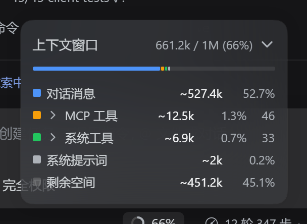
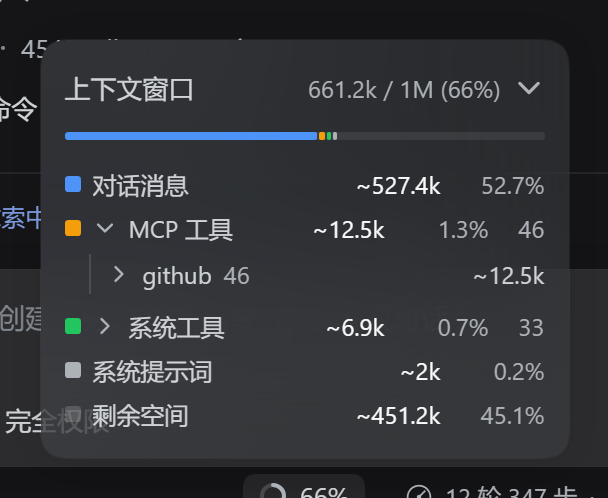
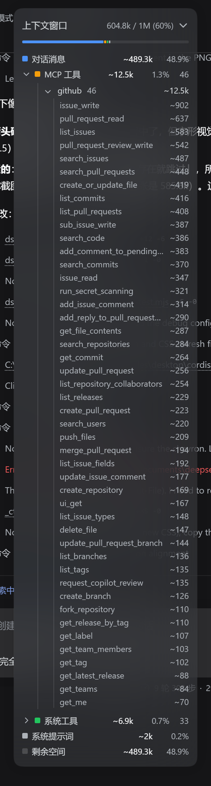
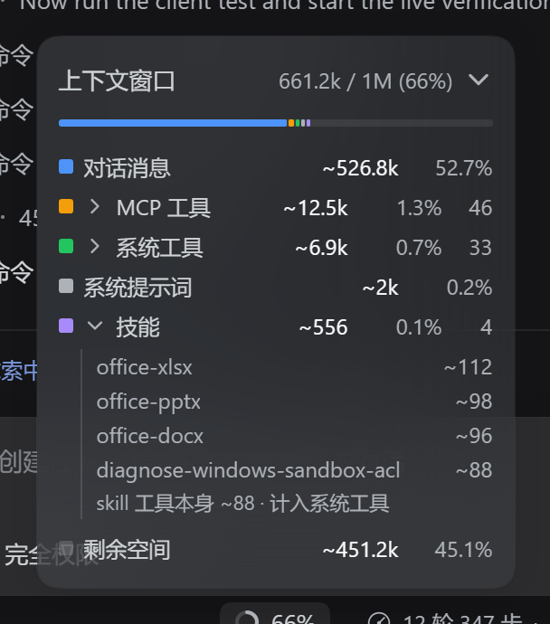

# dsh-context-window — 输入框下方那个「白圈」点开后的弹层

保留 composer 里那个小小的占用圆环（`◔ 57%`）当触发器，**只换掉它点开的弹层**：

- **圆环**：原样保留——同样的 14px 尺寸 / 2px 描边 / track+fill 主题色 / hover 底色 / 百分比读数
- **弹层**：标题行 `上下文窗口 · 572.4k / 1M (57%) · ›` + 一条整窗分段占用条（264px，同 DSH 原生弹层）
- **点标题行**：展开图例 — 对话消息 / MCP 工具 / 系统工具 / 系统提示词 / 技能 / 用量差额（如有） / 剩余空间；图例行本身不展开。
- **图例下方的 MCP 工具 / 系统工具 / 技能**：点击独立的明细按钮，展开可滚动的逐项列表，一次打开一个分类。
- **MCP 明细**：当前设计是平铺 `github · issue_write ~902`，不是服务层 → 工具层的二级展开。Host 仍按服务提供分类数据，用于逐层归一化后平铺展示。弹层不提供停用服务操作或旧版的管理提示。
- **加载与恢复**：工具与技能分类首次加载有独立提示；失败退回官方估算桶并显示原因和「重新读取」。已有成功分类时，刷新失败保留明细并明确标记旧数据，不能把它误当成最新分类。
- **键盘**：用 Enter / Space 打开圆环后，焦点进入弹层标题；Tab 可访问明细与重试按钮，Escape 关闭并返回触发器。Tab 离开这个非模态弹层时关闭，不抢走已落到外部控件的焦点。整层高度限制在当前视窗内，窄高视窗可滚动。

| 圆环 | 弹层 | 展开分项 |
| --- | --- | --- |
|  |  |  |

| 旧版 MCP 服务层（历史） | 旧版 MCP 工具层（历史） | 技能 + skill 工具标注 |
| --- | --- | --- |
|  |  |  |

上图是旧版本 DSH（`desktop` profile）的历史实机截图，不是设计稿；其中二级 MCP 展开不能代表当前的平铺明细。此轮只进行了离线回归，未更新实机截图或进行 live 验收。

## 0.4.1 输入用量缺失时的占用修复

上游输入用量为 `0` 时，官方压力投影可能只剩采样后的新增消息，导致顶部显示 `1.4k` 而分项合计约 `64.4k`。此时圆环和顶部总数改用 `messageTokens + toolsTokens + systemTokens`，顶部显示 `~` 表示估算；缺少输入采样时也采用这一回退。有有效的非零输入/缓存压力时仍使用官方压力投影。

## 每一行的数据来源

| 行 | 来源 | 精确性 |
| --- | --- | --- |
| `572.4k / 1M (57%)` | 有非零输入采样时取官方 `contextPressure`；缺失或为零时取分项估算总和并显示 `~` | 上游采样或估算 |
| 对话消息 | 官方 `contextBreakdown.messageTokens` **减去**技能目录那一条消息 | 启发式估算 |
| MCP 工具 `46` | 最新 `request/header` 里名字为 `mcp__<server>__<tool>` 的工具（dsh-mcp-client 的命名约定），按服务分组 | 分类精确 |
| 系统工具 `33` | 同一批工具里其余的 | 分类精确 |
| 系统提示词 | 官方 `contextBreakdown.systemTokens` | 启发式估算 |
| 技能 `4` | DSH 自己注入的那条 `user/message`（`source.kind = 'skill-catalog'`，带 `entries`）；行内还会标注 `skill 工具本身 ~88 · 计入系统工具` | 精确 |
| 用量差额（如有） | 顶部有效占用 − 图例已知分类合计，可正可负 | 显式对账差额 |
| 剩余空间 | `max(0, 窗口 − 顶部有效占用)` | 上游采样或估算 |

拆分**逐层归一化**到官方总数：`MCP + 系统工具 = 工具定义`、各服务之和 = MCP 行、
`对话消息 + 技能 = 消息`。（某个服务的工具清单被截断时，可见工具保留各自真实单价，
剩余部分由「还有 N 项未显示」承担，不会被摊到可见项上。）

token 价格用 DSH 自己的计价公式（`lib/estimate.js` 是 `@deepseek-ai/dsh-token-meter/estimate` 的同值副本；
宿主插件无法按裸包名导入 DSH 内部包），启发式部分保留 DSH 自己的 `~`；计数（46 / 33 / 4）是精确值。

**仍然不显示**：Memory files、Autocompact buffer —— DSH 现有投影与会话记录里没有对应的精确来源。

## 架构

| 半边 | 文件 | 职责 |
| --- | --- | --- |
| Client | `lib/client.js` | 单一手写 bundle；圆环与纯视图、分类读取 hook、定位/关闭/焦点 hook 保持文件内边界；官方投影实时，分类单飞读取与逐层归一化 |
| Host | `lib/host.v5.js` | 认证 `/api` 通道上的精确路由 `GET /api/context-window.detail?session=<id>`；5s TTL、最多 128 条 LRU 缓存、同会话单飞及取消隔离 |
| 纯函数 | `lib/classify.js` | 工具 MCP/内置分类、按服务分组、技能目录与 skill 工具识别（可离线测） |
| 计价 | `lib/estimate.js` | DSH 计价公式的同值副本（含出处说明） |

为什么圆环要自己画：官方 `ContextMeter` 的「圆环 + 弹层」是同一个组件、硬渲染在本插件座位旁边的兄弟节点，
不是槽位占位者。所以本插件按**结构**识别它（`aria-haspopup="dialog"` + 可访问名带百分比 + 两个圆的占用环）
并 `display:none`，然后在同一位置画一个同款圆环；识别失败只会退化成「多一个环」，不会误隐藏别的控件。

## 安装与重载（重要，含一个坑）

```powershell
plugin_manager install_bundle  target = "D:/path/to/betterDSH/dsh-context-window"
```

- **改 `lib/client.js`**：纯 JS 客户端 bundle，**无构建步骤**。保留单 bundle，不拆动态 chunks。刷新现有 GUI 可重新读取客户端；自动 HMR 还取决于实际发布链路与对应 watcher，不能仅凭存盘保证。
- **改宿主侧任何文件**：装载器**按 specifier 记忆宿主模块**，Node 的 ESM 缓存**按 URL 记忆依赖**——
  所以改文件、关开 bundle 都不会重新导入。热重载的做法是**同时**做两件事：
  1. 使用新入口文件名（例如未来 `host.v5.js` → `host.v6.js`），更新 `package.json` 导出；如配置直接引用入口，也同步那个引用；
  2. 同时递增入口里的 `REVISION`（例如 `'5'` → `'6'`）。
  入口对 `./classify.js` / `./estimate.js` 用的是 `` import(`./classify.js?rev=${REVISION}`) ``，
  这样依赖也会跟着换版本；只改文件名而不改 `REVISION` 会继续命中旧依赖（本次踩过：
  v3 入口拿到了旧 `classify.js`，服务层清单是空的）。
  不想折腾就重启一次 DSH。

## 验证（离线回归与历史实机记录）

| 项目 | 结果 |
| --- | --- |
| `node tools/host-test.mjs` | 纯分类/计价回归：MCP 命名、按服务数据、技能目录、会话折叠与已核实旧用量校正；不等同于 Host 路由生命周期测试 |
| `node tools/route-test.mjs` | 真实 Fetch `Request` + 假 `ctx` / 延迟读取：exact route、错误恢复、TTL/LRU 容量、同会话单飞、请求取消隔离、dispose 清理及迟到结果不回填；无网络、实机会话或配置写入 |
| `node tools/client-test.mjs` | 纯视图与挂载 hook 回归：平铺明细、逐层归一化、官方桶回退、加载/失败/stale/重试、单飞、跨会话/卸载取消、portal 焦点进入/恢复与 Escape/Tab 离开语义；不替代实机验收 |
| 历史实机（旧版真实会话） | 五行：`对话消息 ~466.2k 46.6%`、`MCP 工具 ~12.5k 1.3% 46`、`系统工具 ~6.9k 0.7% 33`、`系统提示词 ~2k 0.2%`、`剩余空间 ~512.3k 51.2%`；点 MCP 出 `github 46 ~12.5k`；再点出 46 个工具逐项（`issue_write ~902`、`pull_request_read ~637` …）；控制台零错误 |
| 实机（宿主路由） | `tools.total=19414`、`mcp=46/12513`、`server github: count=46 tokens=12724 items=46`；`skills: count=4 tokens=556 skillTool=88`（另一会话，含真实技能目录） |
| 技能行 | 行内提示 `skill 工具本身 ~88 · 计入系统工具`（`skill` 工具的 schema 一直算在系统工具的 6906 tok 里） |

`tools/verify-live.mjs` 是实机脚本（CDP 驱动，无第三方依赖）：

```powershell
# 需另行授权实机验收后使用：给宿主半边配可选 debugDumpPath 获取带令牌地址
node tools/verify-live.mjs <authenticatedUrl>
```

## 技能行为什么有时不出现

技能行只在**该会话确实带技能目录**时出现。目录由 DSH 的 `skill` 工具插件按 pre-step 注入，
前提是技能注册表里有「模型可调用」的技能：

- 技能提供者未激活、或注册表没有可调用技能时，不会注入目录消息，技能行也不显示；不能据此断言读取失败。
- 历史验证 profile 曾包含 4 个内置技能（`office-docx/pptx/xlsx`、`diagnose-windows-sandbox-acl`）；当前数量取决于操作者自己的配置，此轮未调整本机插件启停或技能注册表。
- 已经跑起来的会话不会补注入，**新开一个会话**（或在技能变化后的下一轮）才会出现技能行。
- 与技能相关的两种 token 要分清：**技能目录**（那条注入消息，占「技能」行）与
  **`skill` 工具自身的 schema**（约 88 tok，一直在「系统工具」里）——技能行会在明细末尾把这句标出来。

## 已知限制

- Memory files、Autocompact buffer 未实现（无精确来源）。
- 分类 Host 路由默认 5s TTL、最多 128 条会话 LRU 缓存；过期条目在下一次读取/写入时清理，无后台定时器。可选 `cacheTtlMs` 范围 0–600000（0 关闭结果缓存）、`cacheMaxEntries` 范围 1–512。TTL 从读取完成时计时，同一会话的并发 cache miss 共享一次读取，不同会话独立。
- 每个 HTTP 订阅者单独取消；首个请求取消不会终止其他仍在等待的请求，最后一个订阅者取消才 abort 共享读取。插件 dispose 注销路由、清空缓存并取消订阅；底层服务即使忽略 abort，迟到结果也不能回填缓存或覆盖新读取。`observeSession` 返回的 observation 仍会被释放；旧宿主 `readSession` 不支持传 signal 时，只保证结果隔离而非强制中止底层工作。取消请求以 `499 aborted` 返回，dispose 后的旧处理器以 `503 disposed` 返回。
- 客户端打开弹层时每 5s 尝试刷新，但慢请求期间不重叠发起。挂载时进行一次预读取，用于分类及已核实旧用量校正。关闭/换会话/卸载会取消旧请求；网络失败时分类可能滞后更久，界面明确提示旧数据，官方投影仍实时读取。
- 工具/技能的 token 数是 DSH 计价口径的启发式值（带 `~`），不是供应商计费 token；拆分比例来自这些值。
- 无可用分类时（老版本 DSH、路由报错、分类权重尚未读到）退回官方桶：对话消息 / 工具定义 / 系统提示词，另按需要展示用量差额与剩余空间。已有分类时刷新失败会保留并标为旧数据；不会静默把旧明细称为最新数据。
