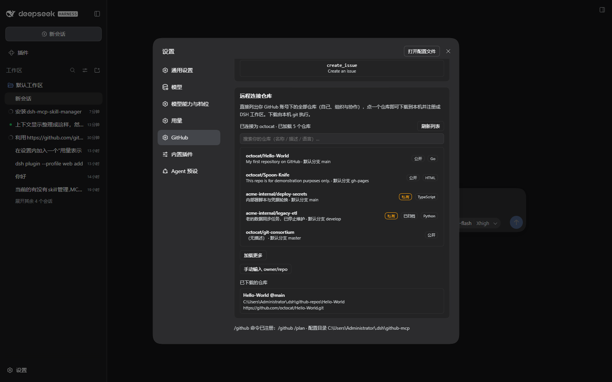
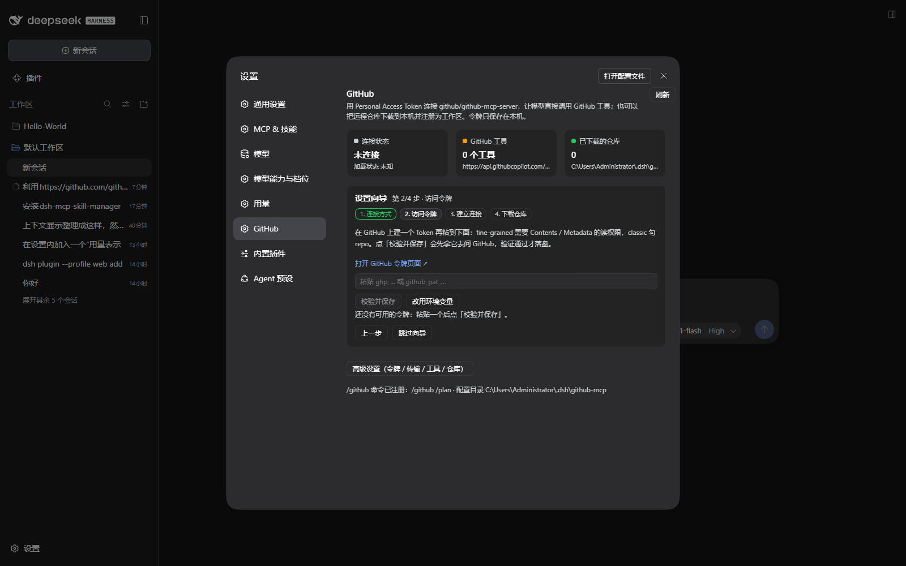
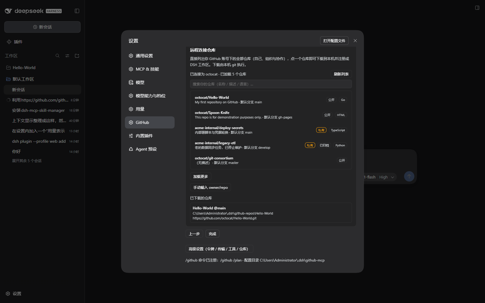

# dsh-github — 设置里的 GitHub 管理 + /github 指令 + 远程连接仓库

三件事，一个插件：

1. **设置 → GitHub**：管理 GitHub 连接。用 Personal Access Token 透过 DSH 自带的
   `@deepseek-ai/dsh-mcp-client` 连上 `github/github-mcp-server`（远程 Streamable HTTP
   或本地 stdio 二选一），页面上直接看连接状态、工具清单，并能单独调用某个工具。
2. **输入栏 `/github`**：人用的入口。`/github` 列出当前可用的 GitHub MCP 工具，
   `/github remote` 列出**你账号下的全部仓库**，`/github call` 调用工具，
   `/github clone` 下载仓库。
3. **远程连接仓库**：连上账号后把仓库列出来（自己 / 组织 / 协作），可搜索、可翻页，
   点一个仓库 → 弹出「即将开始下载」确认 → 本机 `git clone`（实时进度）→
   自动注册成 DSH 工作区。



## 设置向导（第一次打开就是它）

没配好之前，这一页只给向导，不给一堆待填的表单：

| 步骤 | 做什么 | 失败时说清楚什么 |
| --- | --- | --- |
| 1 连接方式 | 默认「远程 Streamable HTTP」；想用本地 `github-mcp-server` 就切 stdio | — |
| 2 访问令牌 | 页内链接直达 GitHub 令牌页，粘贴后点 **校验并保存** | **先拿令牌去问 GitHub**（`GET /user`），通过才落盘；401 / 限流 / 网络错误原样显示，落盘前不写任何东西 |
| 3 建立连接 | 一步启用 MCP 行并把完整 config 写进 profile，随后显示 loader phase 与已发现工具数 | 工具数为 0 时给出「令牌是否仍有效 / toolsets 是否限定了范围 / 重试」的具体指引 |
| 4 下载仓库 | 列出账号下全部仓库，挑一个下载并注册工作区，也可以直接「完成」 | 下载失败显示 git 最后几行 |




向导会**从第一个还没完成的步骤续上**（令牌有了但没连 → 直接从第 3 步开始），
随时可「跳过向导」，完成后页脚留一个「重新运行设置向导」。

为什么不用 DSH 原生的 `settings.onboarding` 插槽：那个插槽一次挂载**一个阻塞模态**，
注册者要自己拥有 modal 表面和 `#root` 的 inert 所有权，用户不完成就走不掉。
GitHub 是可选功能，用阻塞式首启流程不合适，所以向导做在设置页内部——
非阻塞、可跳过、可重入。

## 界面上有什么

| 区块 | 内容 |
| --- | --- |
| 设置向导 | 四步引导（见上）；未完成时占满页面，其余卡片收在「高级设置」后面 |
| 三张状态卡 | 连接状态（含 loader phase）、工具数量与端点、已下载仓库数 |
| 访问令牌 | 令牌来源（本机保存 / 环境变量）、令牌输入与清除；令牌只存本机 |
| 传输方式 | Streamable HTTP 或 stdio、端点 / 可执行文件 / 参数、toolsets、只读、严格启动、下载目录 |
| GitHub 工具 | 服务器暴露的工具列表，可过滤、展开参数、直接调用并看结果 |
| 远程连接仓库 | 账号行、仓库列表（公开/私有/已归档/语言标签）、搜索、加载更多、手动输入兜底、下载确认、实时进度、已下载仓库 |
| 页脚 | `/github` 是否已注册进指令目录、配置目录、重新运行向导 |

控件形态与 DSH 自身一致：开关用 36×20 的 `role=switch` 圆钮，二选一用胶囊分段控件，
全部只用 `--dsw-alias-*` 主题变量（截图见 `docs/screenshots/`）。

## `/github` 的用法

```
/github                          列出可用的 GitHub MCP 工具
/github remote [关键词]          列出你账号下的仓库（含组织与协作），带默认分支与下载命令
/github tools [关键词]           工具参数面
/github call <工具> {JSON}       调用一个工具，例如
                                 /github call get_file_contents {"owner":"octocat","repo":"Hello-World"}
/github clone owner/repo --yes   下载并注册为工作区（不加 --yes 只打印计划与确认方式）
/github repos                    已下载的仓库
/github status                   连接与令牌状态
```

`/github` 已注册进宿主 `commands` 服务，输入栏的 `/` 菜单会把它列出来（实测：
`catalog=[/compact /export /feedback /github /goal /permission /plan]`），
并带上提示词 `[list|tools|call|clone|repos|status|help]`。

## 架构

| 半边 | 文件 | 职责 |
| --- | --- | --- |
| Host | `lib/host.js` | `/api/github.*` 路由、`/github` 指令、MCP 行的配置写入与启停、克隆任务 |
| Host | `lib/remote.js` | GitHub REST 客户端（`/user`、`/user/repos`）、仓库映射、令牌注入与擦除 |
| Host | `lib/mcpconfig.js` | 纯函数：设置归一化、MCP 行 config 生成、仓库地址解析 |
| Host | `lib/commands.js` | 纯函数：指令解析与全部文本输出 |
| Host | `lib/settings.js` | `$DSH_HOME/github-mcp/` 下的设置与令牌文件 |
| Host | `lib/git.js` | `git clone --progress`（流式输出）、`remote set-url`、已下载仓库扫描 |
| Client | `lib/client.js` | `settings.section` 的「GitHub」页（手写 JS，无构建步骤） |

数据流：Client 页 → `fetch('api/github.remote')` 等同源路由（带会话 cookie）→ Host →
GitHub REST / `git` / `ctx.tools` → JSON。MCP 连接本身由 MCP 客户端行建立，不在本插件内。

令牌处理：设置与令牌分开存放，`settings.json` 可随手查看，令牌单独放在 `token`（0600）。
状态路由永远不返回令牌本体，只返回 `ghp_…abcd (n 字符)` 这种掩码；返回给浏览器的下载计划
也从不包含带令牌的地址。

## 已安装位置（本机现状）

`plugin_manager` 已装进 `desktop` profile（就是当前这个应用）：

- `C:\Users\Administrator\.dsh\profiles\desktop\package.json`
  - `dependencies`：`"dsh-github": "link:D:/Backup/Documents/deepseek-harness/default-workspace/dsh-github"`
  - `dsh.profile.bundles`：追加 `dsh-github`
- 本 bundle 的 `cordis.patch.yml` 插入两行：`github-mcp`（MCP 客户端，初始 `disabled: true`，
  没配令牌前不发任何外部连接）与 `github`（本插件的 Host 半边，按绝对路径名条目）
- `node_modules/dsh-github` 是指向本目录的链接，所以**改这里的文件就是改运行中的插件**

安装 / 卸载：

```powershell
# 卸载（插件页里移除该 bundle 亦可）
plugin_manager remove_bundle  target = "dsh-github"
# 重新安装
plugin_manager install_bundle target = "D:\Backup\Documents\deepseek-harness\default-workspace\dsh-github"
```

## 怎么用

设置 → GitHub，跟着向导走：

1. **第 2 步**粘贴 Personal Access Token（fine-grained 需要 Contents / Metadata 读权限，
   classic 勾 `repo`），点「校验并保存」——它会先向 GitHub 确认这个令牌能用，再存到
   `$DSH_HOME/github-mcp/token`（0600），并把 `Authorization` 头写进 MCP 行 config。
2. **第 3 步**点「立即连接」：启用 `github-mcp` 行 → MCP 客户端连上 →
   工具以 `mcp__github__<工具>` 出现，「GitHub 工具」卡片里可以逐个调用。
3. **第 4 步**（可跳过）挑一个仓库下载；搜索框里的词会在服务端向前翻页扫描
   （最多 5 页）后过滤，所以搜索覆盖整个账号而不只是已加载的一页。
4. 点某个仓库 → 弹出「即将开始下载」（显示来源、落地目录、分支）→「确认下载」
   → 看到 git 自己的进度 → 完成后注册为工作区，并出现在「已下载的仓库」里。
   私有仓库会用令牌完成下载，**完成后立即把 `origin` 还原成不含令牌的地址**。

之后从输入栏也能做同样的事：`/github remote` 列仓库，`/github clone <owner/repo> --yes` 下载。

## 验证

| 项目 | 结果 |
| --- | --- |
| `node tools/pure-test.mjs` | **59/59**：设置归一化（含向导标记）、MCP config 生成（两种传输、令牌、无残留字段）、仓库地址解析、指令解析（含 JSON 参数原样保留）、文本输出、客户端静态检查（路由表完整性、不 import Harness 包） |
| `node tools/host-test.mjs` | **60/60**：7 条路由契约、令牌保存/清除/**先校验后落盘**（拒绝时不写任何东西）、连接与断开（含禁用行时的延迟写入）、工具调用与 409、仓库列表与上游错误映射、带令牌克隆与 origin 擦除、全部指令分支 |
| `node tools/client-test.mjs` | **28/28**：把真实 `lib/client.js` 装进假 module loader + 极简 React 里求值——注册形态、向导「该从第几步开始」的 6 种状态、每步渲染出的文案与控件（含"就是圆钮开关不是原生 checkbox"）、卡片的各种空/有状态 |
| `node tools/e2e-check.mjs --clone` | **23/23**（真实运行中的 DSH + 真实 git）：路由可认证、指令已注册、无令牌时拒绝、坏仓库提前拒绝、确认后真下载、**工作区注册成功**、进度流式回传、origin 不含凭据 |
| `node tools/ui-check.mjs --stub-fresh` | 真实页面无头渲染向导首启态：`第 2/4 步 · 访问令牌`，控制台**零错误** |
| `node tools/ui-check.mjs --stub` | 同上渲染已连接态：`第 4/4 步 · 下载仓库` + 账号行 + 仓库列表；`settings.section` 出现 `{registrant:"dsh-github", id:"github", order:14, active:true}` |
| `node tools/bundle-check.mjs` | 运行中的应用**确实**在发最新 revision 的客户端包（按 rev 校验内容） |
| 截图 | `docs/screenshots/`：向导两步、改前/改后控件、未连接、已连接、仓库选择器、下载确认 |

合计 **147** 项离线断言 + 23 项真实运行断言。`tools/` 下的脚本都是本机自检工具，只访问
loopback：它们用 harness 自己保存的 browser-session 签名密钥现签一个会话 cookie
（与浏览器持有的那个同构，密钥不落盘、不打印），以便在真实页面 / 真实路由上做端到端验证。

## 已知限制

- **Host 半边的改动需要重启应用**：加载器按 specifier 记忆已导入的宿主模块，
  开关 bundle 不会重新导入同一个文件。客户端半边按 rev 提供，刷新页面即可见。
  本次新增的 `/api/github.remote`（列仓库）与 `/api/github.token` 的 `verify` 分支都属于
  这一类：代码已装好、已验证，重启应用后生效。重启前向导仍然可用——第 2 步退化成
  「只保存不校验」，第 4 步会提示列表读取失败。
- **MCP 握手需要真令牌**：`/github`、工具清单、`/github call` 都要先完成第 2 步；
  没有令牌时页面与指令都会明确告诉你缺什么，而不是静默失败。
- 仓库列表来自 `/user/repos?affiliation=owner,collaborator,organization_member`，
  即「令牌能看到的全部仓库」；搜索最多向前扫描 5 页（500 个），超出会用关键词提示。
- 令牌来源选「环境变量」时读的是 `GITHUB_PERSONAL_ACCESS_TOKEN`（可改名），
  DSH 启动后不会重读进程环境，所以这种方式适合启动前就设好变量的场景。
- 下载目录默认 `$DSH_HOME/github-repos`，可在「传输方式 → 下载目录」里改。
  验证时下载的 `octocat/Hello-World` 就在这里，并已注册成一个工作区，可自行删除。
- 设置页的导航图标沿用设置外壳的默认图标：`settings.section` 没有图标位。
