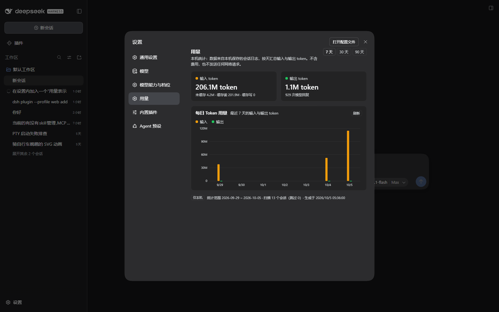

# dsh-usage-report — 设置里的「用量」页

在 DSH 设置的侧栏里加一个 **用量** 页，按天统计**本机**会话的输入 / 输出 token。

**纯本地**：数据全部来自本机保存的会话日志，只在本机 loopback 的 GUI 路由上读取，
不发起任何外部网络请求，不涉及费用、账单或供应商费率。




上图为真实运行中的 DSH（`desktop` profile）截图，不是设计稿。

## 界面内容

- **两个数字卡**
  - 输入 token：并给出 `未缓存 / 缓存读 / 缓存写` 明细
  - 输出 token：并给出模型回复次数
- **每日 Token 用量图**：输入（橙）/ 输出（绿）两条系列的分组柱状图，
  纵轴自适应取整（`120M` 这类刻度）、横轴取 8 个等距日期、悬停显示当天数值；
  右上角 `7 天 / 30 天 / 90 天` 切换与 `刷新`
- **页脚**：`仅本机` 标记、统计范围、扫描 / 跳过会话数、生成时间

## 数据来源与统计口径

- 通过宿主服务 `ctx.sessionQuery.listSessions()` + `readSession()` 读取本机会话，
  只统计 `assistant/message` 事件中 `data.usage` 携带的 token。
- 分桶按事件时间 `time` 落在**本机日历日**（截图机器为 UTC+8）。
- 两条系列的定义：
  - **输入** = `inputTokens + cacheReadTokens + cacheWriteTokens`
  - **输出** = `outputTokens`
  - 本机数据里缓存读占绝大多数，因此“输入远大于输出”是正常现象，卡片里给了明细。
- fork 会话的**继承前缀会被跳过**（那部分是父会话的花费），与 DSH 自身口径一致。
- **口径校验**：对每条存在投影缓存的会话，本模块折出的总数与 DSH 自己的
  `tokenUsage` 投影**逐字段完全相等**（12/12；另 1 条是运行测试时正在写入的本会话，
  其日志必然领先于缓存快照，改用“不小于”断言）。见 `tools/report-test.mjs`。

## 架构

| 半边 | 文件 | 职责 |
| --- | --- | --- |
| Host | `lib/host.js` | 在认证的 `/api` 通道上注册精确路由 `GET /api/usage.report?range=30`，聚合并缓存（默认 60s、同范围单飞） |
| Client | `lib/client.js` | `window.__ModuleLoader__.load` 形态的纯 JS 包（**无需构建步骤**），向 `settings.section` 注册 `id: usage`、`order: 13`，读取 `api/usage.report`，用 `--dsw-alias-*` 主题变量渲染 |
| 共用 | `lib/report.js` | 纯函数聚合核心，两个半边与离线测试共用 |

数据流：Client 页 → `fetch('api/usage.report?range=N')`（同源、带会话 cookie）
→ Host 路由 → `sessionQuery` 折叠本机会话 → JSON → 页内 SVG 柱状图。出口只有本机 loopback。

## 已安装的位置（本机现状）

`plugin_manager` 已把它装进 `desktop` profile：

- `C:\Users\Administrator\.dsh\profiles\desktop\package.json`
  - `dependencies`：`"dsh-usage-report": "link:D:/Backup/Documents/deepseek-harness/default-workspace/dsh-usage-report"`
  - `dsh.profile.bundles`：追加 `dsh-usage-report`
- profile 的 `cordis.patch.yml` 末尾由管理器记录了一行 `- id: usage-report` / `disabled: false`
- profile 的 `node_modules/dsh-usage-report` 是指向本目录的链接，所以**改这里的文件就是改运行中的插件**

安装 / 卸载：

```powershell
# 卸载（插件页里移除该 bundle 亦可）
plugin_manager remove_bundle  target = "dsh-usage-report"
# 重新安装
plugin_manager install_bundle target = "D:\Backup\Documents\deepseek-harness\default-workspace\dsh-usage-report"
```

安装前的 profile 配置备份在
`_usage-work\backup-20261005-045443\`（`package.json`、`cordis.patch.yml`、`pnpm-lock.yaml` 等）。

## 验证（本机实测）

| 项目 | 结果 |
| --- | --- |
| `node tools/report-test.mjs` | **59/59** 通过，含 12/12 与 DSH `tokenUsage` 投影逐会话对账 |
| `node tools/host-test.mjs` | **41/41** 通过：路由契约、报告内容、范围回退、缓存/单飞、失败隔离 |
| `node tools/client-test.mjs` | **63/63** 通过：bundle 可解析、注册、`loading / ready / error` 三态渲染、图表几何与坐标轴 |
| 合计 | **163/163**（`node --test` 之外的三支零依赖脚本，`package.json` 的 `npm test` 串起全部三支） |
| 实机渲染 | 无头 Chrome 打开认证 URL → 设置 → 用量：控制台**零错误**；`7 天 / 30 天 / 90 天` 切换正常（两张截图） |
| 运行期 Inspector | `settings.section` 占用者出现 `{ registrant: "dsh-usage-report", id: "usage", order: 13, active: true }` |
| Host 半 | 该条目 `application: applied`、无 warning；路由实测返回真实报告（13 个会话、0 跳过、3 个活跃日） |

两个测试都不需要网络，也都可以在任意机器上重跑（会读本机 `$DSH_HOME` 下的会话）。

## 已知限制

- 侧栏**图标是设置面板的通用齿轮**：`settings.section` 没有图标位，DSH 的设置外壳按
  section id 硬编码图标（`navIcon(id)`），第三方 section 只能拿到默认齿轮。
- 一次统计最多扫描 `maxSessions`（默认 500）条会话，被截断的数量记在 `meta.truncatedSessions`。
- 读取失败 / 无法回放的会话不会让页面失败，页脚 `title` 里给出前 5 条原因。
- 长会话跨天时按**事件时间**精确分桶，不会整段算到会话开始那天。
- 文案跟随 DSH 语言（内置 zh / en 词条），目前其余语言回退到 en。
- 输出条在输入极大的日子会显得很细（共享线性刻度）；非零值保证至少 2px，可用悬停看准确数。

## 改完怎么生效（重要）

- **改 `lib/client.js`**：DSH 的 client HMR 按产物 rev 自动重载，刷新页面即可见（本目录是链接安装，改文件即改产物）。
- **改 `lib/host.js`**：加载器按 **specifier** 记忆已导入的宿主模块，同一个条目**不会**重新导入。
  需要重载该条目才生效（插件页里开关一次，或 `plugin_manager set_bundle` 关 → 开）。
  `cordis.patch.yml` 里条目名用绝对路径，正是为了在**不重启应用**的前提下换文件生效；
  若把条目名改回包名（移植写法，见该文件注释），改动只在下次启动进程时生效。

## 文件

```
dsh-usage-report/
├── package.json          # dsh.bundle.patch + dsh.client(platform: web) 声明
├── cordis.patch.yml      # 往 profile 里插一行：id=usage-report
├── lib/
│   ├── host.js           # Host 半：/api/usage.report 路由 + 聚合缓存
│   ├── client.js         # Client 半：settings.section「用量」页（手写 JS，无构建）
│   └── report.js         # 纯函数：按本地日分桶、汇总、组装报告
├── docs/screenshots/     # 实机截图（30 天 / 7 天）
├── tools/
│   ├── report-test.mjs   # 聚合 + 真实日志对账（59 项）
│   ├── client-test.mjs   # 客户端 bundle 离线渲染测试（63 项）
│   ├── screenshot.mjs    # 无头 Chrome CDP 驱动：打开设置→用量并截图
│   ├── asar.mjs          # 读已安装 app.asar 的条目（研究用）
│   ├── scan.mjs          # 在 app.asar 里按字面量搜代码（研究用）
│   ├── zstd-jsonl.mjs    # 解码 DSH 的 zstd 分帧 JSONL 会话日志（研究/测试用）
│   └── probe-session.mjs # 打印某个会话的事件类型与 usage 汇总（研究用）
└── refs/                 # 从本机已安装 app.asar 抽出的 DSH 源码片段（只读参考，不参与运行）
```

`refs/` 仅作实现参考：它们解释了 `settings.section` 注册形态、`connection.fetch` 路由契约、
client bundle 的加载与 HMR 规则。运行时不依赖其中任何文件。
